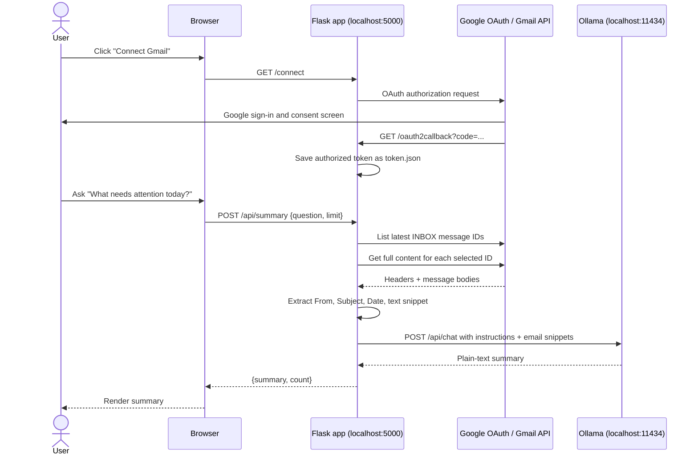
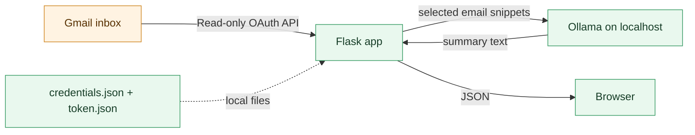

# Low-level design: Inbox Brief

## Goal

Inbox Brief is a local web application. It lets one user authenticate with Gmail, fetch a limited number of inbox emails, and ask a local LLM to summarize them or answer an inbox question.

The model setup is **Ollama + `gemma3:1b`**. Both run on the user's computer, so the email content is not sent to an AI provider.

## Components

| Component | Responsibility | Data it holds |
|---|---|---|
| Browser | Displays chat UI and starts requests | Prompt, selected email limit, rendered answer |
| Flask (`app.py`) | Auth, Gmail read, prompt construction, API endpoints | Temporary OAuth state; no email database |
| `credentials.json` | Identifies this app to Google OAuth | Google OAuth client ID/secret |
| `token.json` | Authorizes future Gmail reads | User's refresh/access token; local only |
| Gmail API | Lists and returns inbox email messages | User's Gmail mailbox |
| Ollama | Runs an LLM HTTP server at `localhost:11434` | Downloaded model and current prompt only |
| Gemma 3 1B | Turns retrieved email snippets into a response | Context supplied in one request |

## Runtime flow



## Request-level design

### `GET /`

Renders `templates/index.html`. It checks whether `token.json` exists and shows either **Connect Gmail** or the chat panel.

### `GET /connect`

1. Reads local `credentials.json`.
2. Creates a Google OAuth authorization URL with the sole scope `gmail.readonly`.
3. Saves an anti-forgery `state` value in the Flask session.
4. Redirects the browser to Google.

### `GET /oauth2callback`

1. Confirms the OAuth state.
2. Exchanges the received authorization code for credentials.
3. Writes credentials to `token.json`.
4. Redirects to `/`.

### `POST /api/summary`

Input:

```json
{ "question": "Which email is urgent?", "limit": 12 }
```

Processing:

1. Clamp `limit` to 1–25.
2. Refresh the stored Google token if needed.
3. Call `users.messages.list` with `labelIds=INBOX`.
4. For each selected ID, call `users.messages.get(format=full)`.
5. Extract `From`, `Subject`, and `Date` headers; decode `text/plain` content (or fall back to stripped HTML).
6. Trim every message body to a fixed length before it goes to the model.
7. Send a strict prompt to Ollama: summarize only supplied emails, highlight deadlines/actions, and do not invent facts.
8. Return the generated answer.

Output:

```json
{ "summary": "• Follow up with…", "count": 12 }
```

### `POST /disconnect`

Deletes only the local `token.json` file and returns to `/`. For complete revocation, the user can also remove the app from their Google Account permissions.

## Data boundaries



With Ollama, email snippets never leave the machine after Gmail returns them. Google still sees normal OAuth and Gmail API activity. If the app uses Gemini/OpenAI/Groq instead, the snippet bundle is transmitted to that provider; this must be opt-in and clearly disclosed in the UI.

## Code changes for Ollama

`summarize()` makes this local HTTP call:

```python
from urllib.request import Request, urlopen

request = Request(
    "http://127.0.0.1:11434/api/chat",
    data=json.dumps({
        "model": "gemma3:1b",
        "stream": False,
        "messages": [{"role": "user", "content": prompt}],
    }).encode("utf-8"),
    headers={"Content-Type": "application/json"},
    method="POST",
)
with urlopen(request, timeout=120) as response:
    answer = json.loads(response.read())["message"]["content"]
```

The UI exposes a safe API trace after each request: Gmail method names, Ollama endpoint, model, email count, and prompt size. It deliberately never displays full email content in this trace. The app should return a clear error if Ollama is not running. Model output remains a suggestion: display the source sender and subject in the summary when practical, and do not take autonomous actions such as deleting, sending, or archiving email.

## Failure behavior

| Failure | App response |
|---|---|
| No `credentials.json` | Explain Google OAuth setup is incomplete |
| No `token.json` | Show Connect Gmail button |
| Expired token | Refresh it automatically; ask user to reconnect if refresh fails |
| Gmail API error | Return a human-readable failure; do not expose token data |
| Ollama offline/model missing | Return “Start Ollama and run `ollama pull gemma3:1b`” |
| Oversized inbox payload | Limit email count and per-message text before inference |

## Local setup topology

```text
Browser ──────────── http://localhost:5000 ─────────── Flask
                                                        │
Google OAuth / Gmail API ──────────────────────────────┤
                                                        │
Flask ───────────── http://localhost:11434 ─────────── Ollama + gemma3:1b
```
